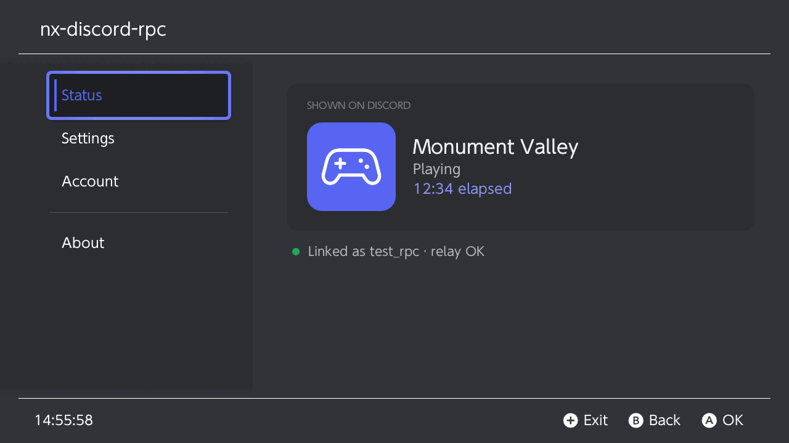
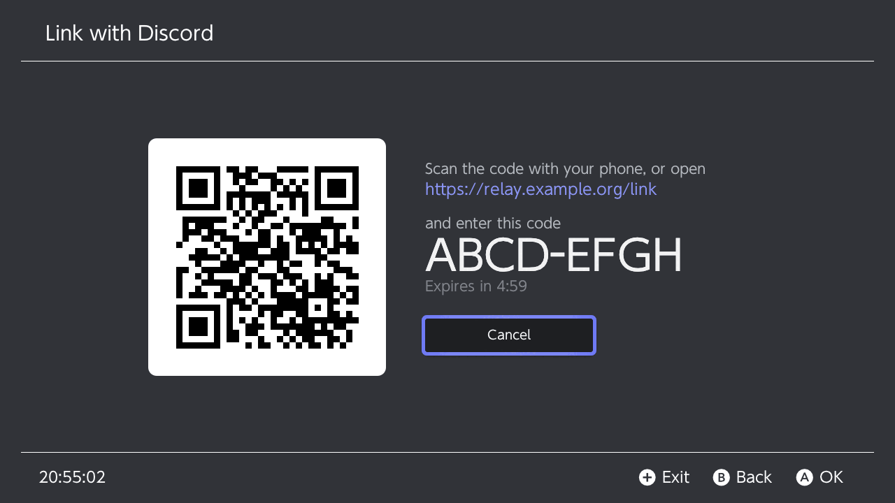
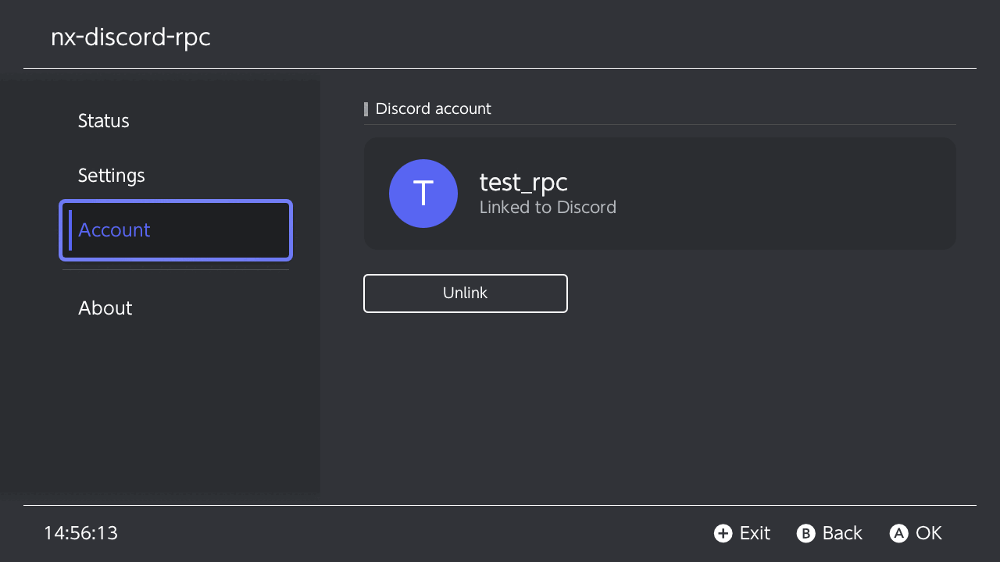
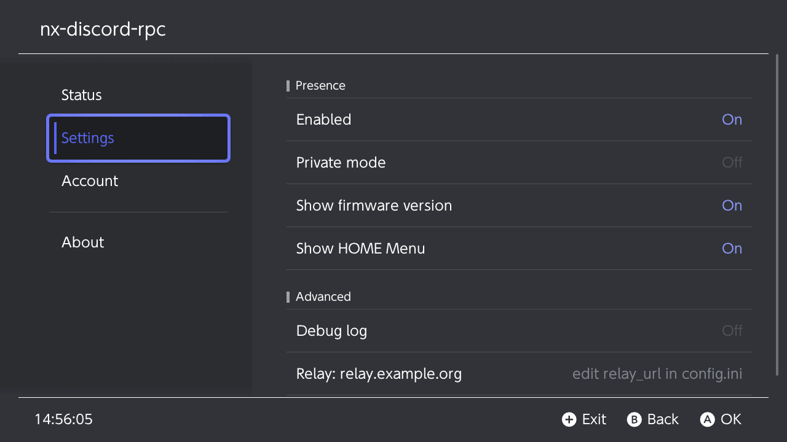

# nx-discord-rpc

Show the game you are playing on your Nintendo Switch as your Discord status.

## What it does

nx-discord-rpc shows the game being played on your Switch as Discord Rich Presence, with the game
name, the elapsed time and the game's icon. It has three parts:

- a sysmodule that runs in the background, starts at boot and reports the running game;
- an app, started from the Homebrew Menu, that shows the status, edits the settings and links your
  Discord account;
- an overlay for Tesla Menu or Ultrahand that toggles the settings while you play.

The console does not talk to Discord directly. It sends the current game to a relay, which shows it
on your profile through Discord's official Social SDK. See [Privacy](#privacy) for what the relay
receives and keeps.

## Requirements

- A Switch running [Atmosphère](https://github.com/Atmosphere-NX/Atmosphere).
- For the overlay: nx-ovlloader with Tesla Menu or Ultrahand.

## Install

1. Download `nx-discord-rpc-X.Y.Z.zip` from the
   [Releases](https://github.com/0xsharkboy/nx-discord-rpc/releases) page.
2. Extract it at the root of the SD card. It holds two folders, `atmosphere` and `switch`, and puts
   the sysmodule, the app (`switch/nx-discord-rpc/nx-discord-rpc.nro`) and the overlay
   (`switch/.overlays/nx-discord-rpc.ovl`) in place.
3. Reboot the console so the sysmodule starts.

## Link your Discord account

1. Open the Homebrew Menu and start nx-discord-rpc.
2. Go to the Account tab and choose Link with Discord.
3. Scan the QR code with your phone, or open the address shown and enter the code.
4. Approve the request on Discord.

The app then shows "Linked as" followed by your Discord username, and the game you are playing
appears on your profile within a few seconds. The Status tab shows what is currently shown on
Discord and the state of the relay.

As a fallback, you can link without the app: write the API key issued by the relay to
`sdmc:/config/nx-discord-rpc/api_key.txt`. The sysmodule imports it at boot, or within 30 seconds
while it has no working key, saves it to `config.ini`, then deletes the file. After a rejected key
or a broken Discord link, a new `api_key.txt` is needed.

## Settings

The Settings tab of the app and the overlay edit the same settings. A change applies within about a
second and is written to `config.ini` after about 2 seconds without further changes. The app has
Enabled, Private mode, Show firmware version, Show HOME Menu and Debug log. The overlay has the same
toggles except Debug log, and labels the firmware one "Show firmware". The relay URL cannot be changed
from either: edit `relay_url` in `config.ini`.

The file is `sdmc:/config/nx-discord-rpc/config.ini`, one `key = value` per line. The sysmodule
reads it at boot and rewrites it whenever a setting changes from the app or the overlay, so edit it
while the console is off (SD card in a PC), never on a running console.

| Key | Default | Meaning |
| --- | --- | --- |
| `enabled` | `true` | Report the presence at all |
| `private_mode` | `false` | Show "Playing a game" instead of the title |
| `show_firmware` | `false` | Append the firmware version |
| `show_home_menu` | `false` | Report the HOME Menu too |
| `debug_log` | `false` | Write debug lines to the log |
| `relay_url` | `https://nx-discord-rpc.0xsharkboy.dev` | The relay's base URL (https only), editable in `config.ini` only. Empty uses the default. An invalid URL disables sending, and the API key never goes to another host |
| `api_key` | empty | The API key issued by the relay when you link. Written by the sysmodule, not meant to be edited |
| `admin_key` | empty | Optional relay admin key, used only for icon uploads. Leave it empty |
| `username` | empty | The Discord username shown by the app and the overlay. Informational only |

Title icons are uploaded to the relay automatically, once per title and session. None are uploaded
in private mode or on the HOME Menu.

## Privacy

- **What the relay receives:** your Discord link (to show the presence on your account), the name of
  the game you are playing, the elapsed time and the game's icon.
- **What it keeps:** no play history. The current game is held in memory only, to send it to
  Discord. Your Discord OAuth tokens are encrypted at rest. The
  [how it works](https://github.com/0xsharkboy/nx-discord-rpc-relay/blob/main/docs/how-it-works.md)
  page lists everything else the relay stores, such as your Discord user id and username, and icon
  votes for about 30 days.
- **Unlinking:** choose Unlink in the Account tab. You can also revoke "NX RPC" in Discord, under
  User Settings > Authorized Apps.
- **Who runs it:** the relay is operated by the author of this project. Its code is public at
  [nx-discord-rpc-relay](https://github.com/0xsharkboy/nx-discord-rpc-relay), and you can run your own:
  follow the
  [self-hosting guide](https://github.com/0xsharkboy/nx-discord-rpc-relay/blob/main/docs/self-hosting.md),
  then set `relay_url` in `config.ini`.
- **Your Discord login:** your Discord password and account token are never used. Linking is approved
  on discord.com, and the console only holds an API key issued by the relay.

## Troubleshooting

- The log is `sdmc:/config/nx-discord-rpc/log.txt`. Keys are masked in it. Turn on Debug log in the
  Settings tab (`debug_log`) for more detail.
- If the app says "nx-discord-rpc is not running", check that the sysmodule is installed in
  `atmosphere/contents/4200000000D15C0D` on the SD card, then reboot.
- If the Status tab says "Relay rejected the key. Link again" or "Discord link broken. Link again",
  go to the Account tab and choose Link with Discord again.
- If Unlink cannot reach the relay, the app offers Forget locally. It only clears the key on the
  console, and Discord keeps the authorization until you remove it in Discord's settings.

## Building from source

Everything comes from the Nix flake.

    nix develop -c make test
    nix develop -c make dist

`make dist` builds the sysmodule, the app and the overlay into `out/`. To preview the app on a PC:

    nix develop .#desktop -c make app-desktop
    build/app-desktop/nx-discord-rpc --fake linked-game

The README screenshots come from `nix develop .#desktop -c make screenshots`. Before trusting a
build on a console, run the [hardware checklist](docs/hardware-checklist.md). The wire protocol is
described in [docs/protocol.md](docs/protocol.md).

## License

GPL-3.0-or-later. See [LICENSE](LICENSE).
