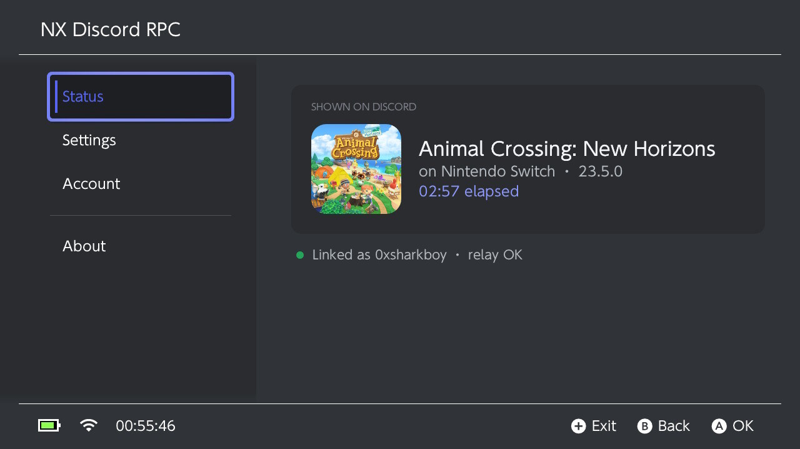

# NX Discord RPC

Show the game you are playing on your Nintendo Switch as your Discord status.

  
  &nbsp;&nbsp;
  

## What it does

NX Discord RPC shows the game being played on your Switch as Discord Rich Presence, with the game
name, the elapsed time and the game's icon. It has three parts:

- a sysmodule that runs in the background, starts at boot and reports the running game;
- an app, started from the Homebrew Menu, that shows the status, edits the settings and links your
  Discord account;
- an overlay for Tesla Menu or Ultrahand that toggles the settings while you play.

The console does not talk to Discord directly. It sends the current game to a relay, which shows it
on your profile through Discord's official Social SDK. See [Privacy](#privacy) for what the relay
receives and keeps.

## Requirements

- A Switch running [Atmosphère](https://github.com/Atmosphere-NX/Atmosphere).
- For the overlay: nx-ovlloader with Tesla Menu or Ultrahand.

## Install

1. Download `nx-discord-rpc-X.Y.Z.zip` from the
   [Releases](https://github.com/0xsharkboy/nx-discord-rpc/releases) page.
2. Extract it at the root of the SD card. It holds two folders, `atmosphere` and `switch`, plus
   `THIRD_PARTY_NOTICES.md` (licenses, safe to delete), and puts
   the sysmodule, the app (`switch/nx-discord-rpc/nx-discord-rpc.nro`) and the overlay
   (`switch/.overlays/nx-discord-rpc.ovl`) in place.
3. Reboot the console so the sysmodule starts.

## Link your Discord account

1. Open the Homebrew Menu and start NX Discord RPC.
2. Go to the Account tab and choose Link with Discord.
3. Scan the QR code with your phone, or open the address shown and enter the code.
4. Approve the request on Discord.

  
  

The app then shows your Discord picture, "Linked as" followed by your Discord username, and the game
you are playing appears on your profile within a few seconds. The Status tab shows what is
currently shown on Discord and the state of the relay.

As a fallback, you can link without the app: write the API key issued by the relay to
`sdmc:/config/nx-discord-rpc/api_key.txt`. The sysmodule imports it at boot, or within 30 seconds
while it has no working key, saves it to `config.ini`, then deletes the file. After a rejected key
or a broken Discord link, a new `api_key.txt` is needed.

## Settings

The Settings tab of the app and the overlay edit the same settings. A change applies within about a
second and is written to `config.ini` after about 2 seconds without further changes. The app has
Enabled, Private mode, Show firmware version, Show HOME Menu, Show paused games, Show docked or
handheld, Show total playtime and Debug log. The overlay has the same toggles except Debug log, and
labels them "Show firmware", "Show paused", "Show docked" and "Show playtime". The relay URL cannot be changed
from either: edit `relay_url` in `config.ini`.

The app also has Start at boot, which is not stored in `config.ini`: it adds or removes the
sysmodule's `boot2.flag` for Atmosphère and applies at the next boot. When the sysmodule is not
running, the app offers Start now, which starts it for the current session only.

The file is `sdmc:/config/nx-discord-rpc/config.ini`, one `key = value` per line. The sysmodule
reads it at boot and rewrites it whenever a setting changes from the app or the overlay, so edit it
while the console is off (SD card in a PC), never on a running console.

| Key | Default | Meaning |
| --- | --- | --- |
| `enabled` | `true` | Report the presence at all |
| `private_mode` | `false` | Show "Playing a game" instead of the title |
| `show_firmware` | `false` | Append the firmware version |
| `show_home_menu` | `false` | Report the HOME Menu too |
| `show_paused` | `true` | Show a game as paused while another screen is in front |
| `show_docked` | `false` | Append Docked or Handheld |
| `show_playtime` | `false` | Append the total playtime of the current profile on this console |
| `debug_log` | `false` | Write debug lines to the log |
| `relay_url` | `https://nx-discord-rpc.0xsharkboy.dev` | The relay's base URL (https only), editable in `config.ini` only. Empty uses the default. An invalid URL disables sending, and the API key never goes to another host |
| `api_key` | empty | The API key issued by the relay when you link. Written by the sysmodule, not meant to be edited |
| `admin_key` | empty | No longer used. Icons always use the API key. Leave it empty |
| `username` | empty | The Discord username shown by the app and the overlay. Informational only |
| `discord_id`, `avatar` | empty | Your Discord user id and avatar hash, used to show your picture. Written by the sysmodule, not meant to be edited |

With Show paused games on, a game shows "Paused · HOME Menu", "Paused · Nintendo eShop",
"Paused · Album" or "Paused · User page" while one of those screens is in front. Other screens a
game opens, such as the keyboard, still count as playing. While paused, no elapsed time is sent.
Show docked or handheld adds "Docked" or "Handheld" to the details. Show total playtime adds your
total playtime in this game on this console, for example "45 min total" or "152 h total". With
Show HOME Menu on, the HOME Menu itself shows "In the HOME Menu". A game being played shows "on
Nintendo Switch". In private mode the game name, icon and playtime are hidden, while Docked or
Handheld still shows if turned on.

Title icons are sent automatically. The console sends the icon's hash, and the relay asks for the
image only if it does not have it yet. None are uploaded in private mode or on the HOME Menu.

## Privacy

- **What the relay receives:** your Discord link (to show the presence on your account), the name and
  title id of the game you are playing, the details line, the elapsed time and the hash of the game's icon.
  The icon image is sent only when the relay does not have it yet.
- **Icons:** each image is stored once, with no link to you or to a title. The console reads your
  playtime and sends only the text.
- **What it keeps:** no play history. The current game is held in memory only, to send it to
  Discord. Your Discord OAuth tokens are encrypted at rest. The
  [how it works](https://github.com/0xsharkboy/nx-discord-rpc-relay/blob/main/docs/how-it-works.md)
  page lists everything else the relay stores, such as your Discord user id and username, and icon
  votes for about 30 days. It also keeps your avatar id, to tell the app which picture to show.
- **Your picture:** the app downloads your Discord picture from `cdn.discordapp.com` without any
  token. The request carries the app's User-Agent (`nx-discord-rpc/<version>`), and Discord sees your
  console's IP address. The picture is cached in `sdmc:/config/nx-discord-rpc/avatar.png` and
  `avatar.key`, which the app deletes after you unlink.
- **Unlinking:** choose Unlink in the Account tab. Revoking NX RPC in Discord stops the presence;
  Unlink in the app also deletes your data on the relay. You can revoke it in Discord, under
  User Settings > Authorized Apps.
- **Who runs it:** the relay is operated by the author of this project. Its code is public at
  [nx-discord-rpc-relay](https://github.com/0xsharkboy/nx-discord-rpc-relay), and you can run your own:
  follow the
  [self-hosting guide](https://github.com/0xsharkboy/nx-discord-rpc-relay/blob/main/docs/self-hosting.md),
  then set `relay_url` in `config.ini`.
- **Your Discord login:** your Discord password and account token are never used. Linking is approved
  on discord.com, and the console only holds an API key issued by the relay.

## Troubleshooting

- The log is `sdmc:/config/nx-discord-rpc/log.txt`. Keys are masked in it. Turn on Debug log in the
  Settings tab (`debug_log`) for more detail.
- If the app says "NX Discord RPC is not running", press Start now and turn Start at boot back on in
  Settings if it is off. If it does not start, check that the sysmodule is installed in
  `atmosphere/contents/4200000000D15C0D` on the SD card, then reboot.
- Nothing shows on my profile: in Discord, User Settings > Activity Privacy, turn on sharing your
  activity.
- If the Status tab says "Relay rejected the key. Link again" or "Discord link broken. Link again",
  go to the Account tab and choose Link with Discord again.
- If Unlink cannot reach the relay, the app offers Forget locally. It only clears the key on the
  console, and Discord keeps the authorization until you remove it in Discord's settings.

## Building from source

Everything comes from the Nix flake.

    nix develop -c make test
    nix develop -c make dist

`make dist` builds the sysmodule, the app and the overlay into `out/`. To preview the app on a PC:

    nix develop .#desktop -c make app-desktop
    build/app-desktop/nx-discord-rpc --fake linked-game

The README screenshots are captures from a console. `nix develop .#desktop -c make screenshots`
renders the same screens from the desktop build into `build/screenshots/`. Before trusting a
build on a console, run the [hardware checklist](docs/hardware-checklist.md). The wire protocol is
described in [docs/protocol.md](docs/protocol.md), a copy of
[nx-discord-rpc-relay/docs/protocol.md](https://github.com/0xsharkboy/nx-discord-rpc-relay/blob/main/docs/protocol.md).

## Third-party code

The binaries include the following. Full license texts and notices are in
[THIRD_PARTY_NOTICES.md](THIRD_PARTY_NOTICES.md), which is also at the root of the release zip.

- [Borealis](https://github.com/xfangfang/borealis) (xfangfang fork), Apache-2.0, in the app. Its
  NOTICE credits the borealis contributors. It bundles Yoga, tweeny, {fmt}, libromfs and libpulsar
  (MIT), nanovg (zlib) and Material icons (Apache-2.0), all covered in the notices file.
- [libtesla](https://github.com/WerWolv/libtesla), GPL-2.0-or-later, in the overlay.
- [Nayuki QR Code generator](https://github.com/nayuki/QR-Code-generator), MIT
  (`app/lib/qrcodegen/LICENSE`), in the app.
- [libnx](https://github.com/switchbrew/libnx), ISC, in the sysmodule, app and overlay.
- [deko3d](https://github.com/devkitPro/deko3d), zlib, linked by the app (`USE_DEKO3D=ON`).

## License

GPL-3.0-or-later. See [LICENSE](LICENSE).
