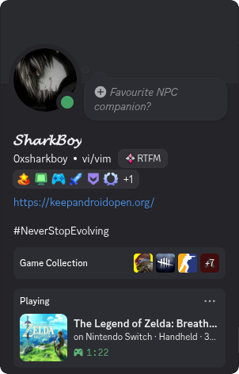
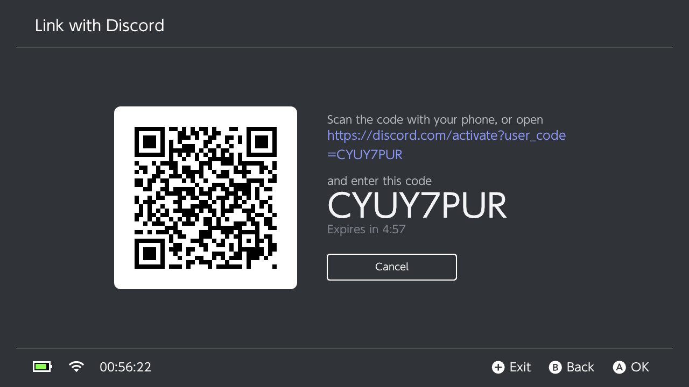
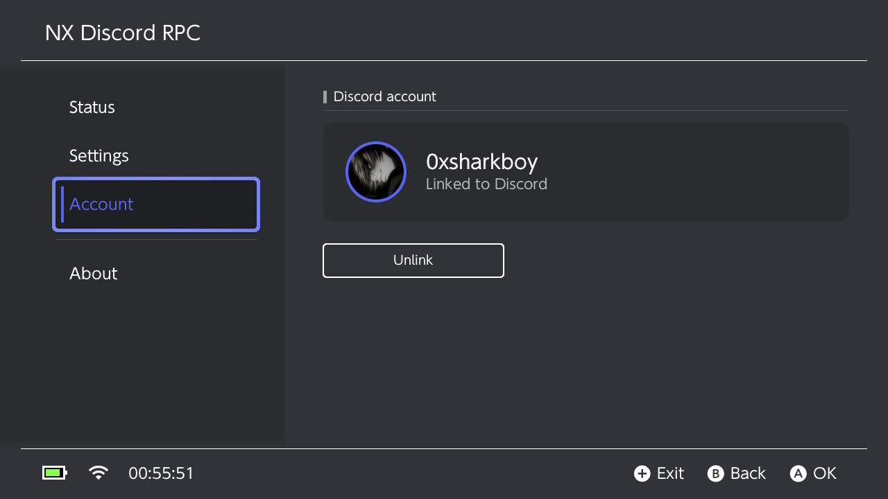
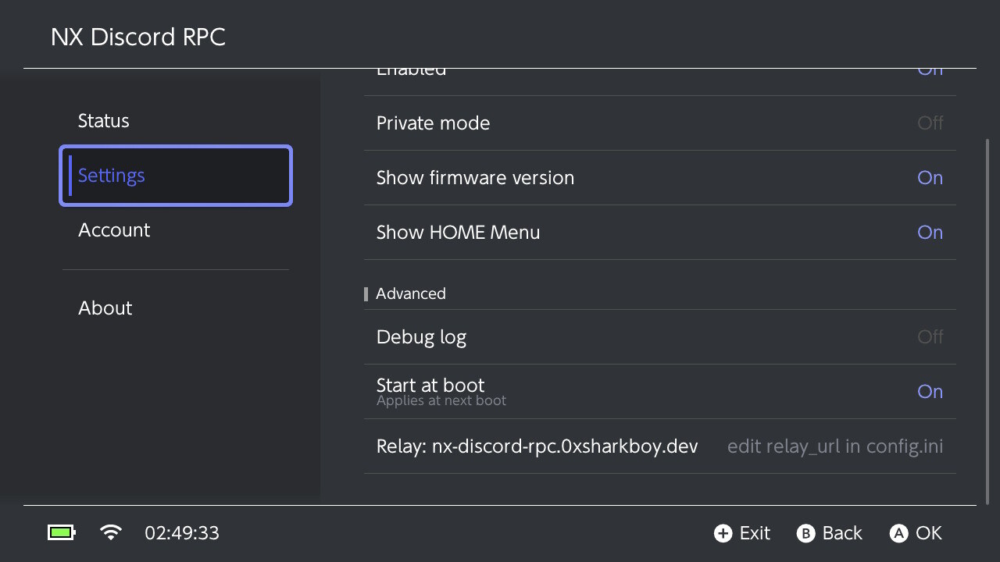
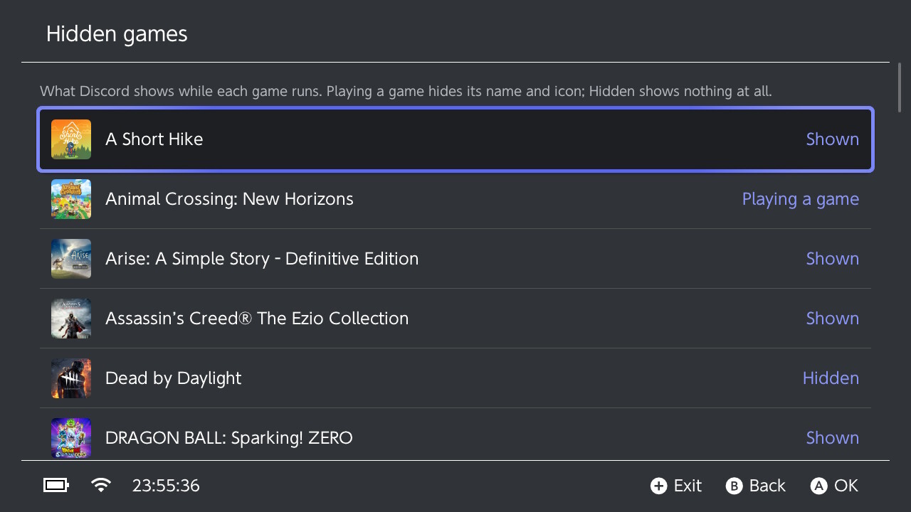
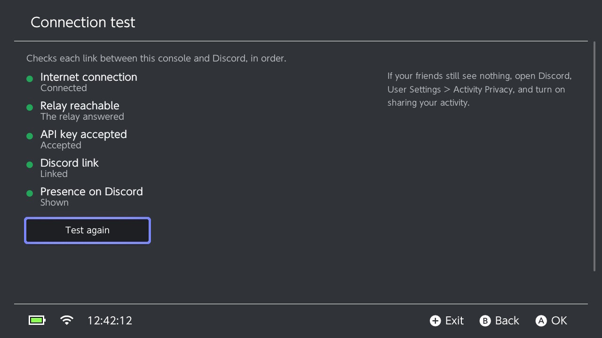
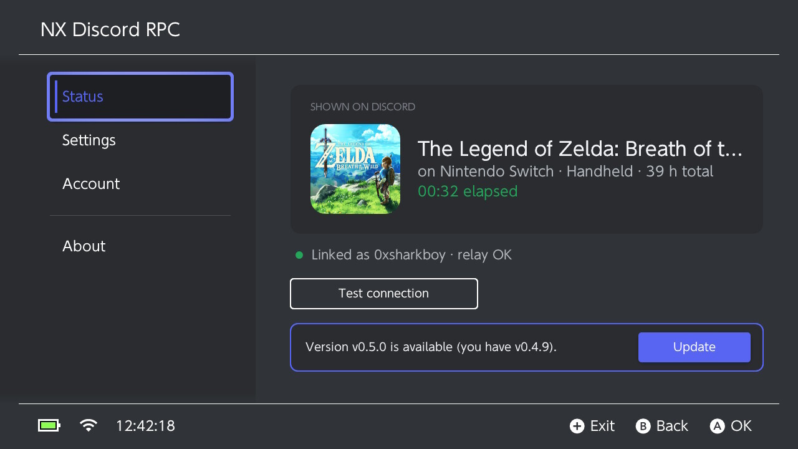
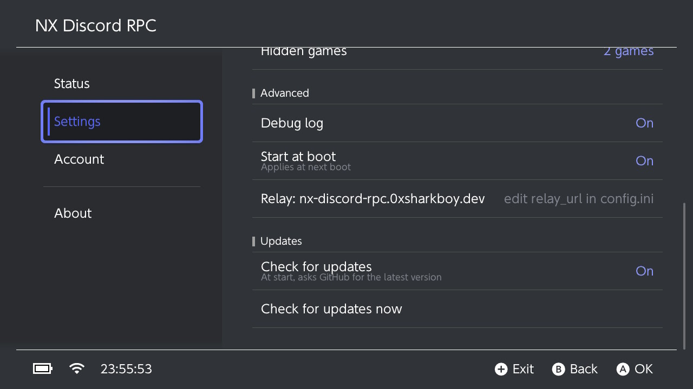

# NX Discord RPC

Show the game you are playing on your Nintendo Switch as your Discord status.

  
  &nbsp;&nbsp;
  

## What it does

NX Discord RPC shows the game being played on your Switch as Discord Rich Presence, with the game
name, the elapsed time and the game's icon. It has three parts:

- a sysmodule that runs in the background, starts at boot and reports the running game;
- an app, started from the Homebrew Menu, that shows the status, edits the settings, picks the games
  to hide, tests the connection, updates itself and links your Discord account. It follows the
  console language: it is available in English and French, and any other language falls back to
  English;
- an overlay for Tesla Menu or Ultrahand that toggles the settings while you play.

The console does not talk to Discord directly. It sends the current game to a relay, which shows it
on your profile through Discord's official Social SDK. See [Privacy](#privacy) for what the relay
receives and keeps.

## Requirements

- A Switch running [Atmosphère](https://github.com/Atmosphere-NX/Atmosphere).
- For the overlay: nx-ovlloader with Tesla Menu or Ultrahand.

## Install

1. Download `nx-discord-rpc-X.Y.Z.zip` from the
   [Releases](https://github.com/0xsharkboy/nx-discord-rpc/releases) page.
2. Extract it at the root of the SD card. It holds two folders, `atmosphere` and `switch`, plus
   `THIRD_PARTY_NOTICES.md` (licenses, safe to delete), and puts
   the sysmodule, the app (`switch/nx-discord-rpc/nx-discord-rpc.nro`) and the overlay
   (`switch/.overlays/nx-discord-rpc.ovl`) in place.
3. Reboot the console so the sysmodule starts.

To update later, use the app (see [Updates](#updates)). Releases before v0.5.0 have no updater: they
must be updated manually once, by extracting the new zip over the old files.

## Link your Discord account

1. Open the Homebrew Menu and start NX Discord RPC.
2. Go to the Account tab and choose Link with Discord.
3. Scan the QR code with your phone, or open the address shown and enter the code.
4. Approve the request on Discord.

  
  

The app then shows your Discord picture, "Linked as" followed by your Discord username, and the game
you are playing appears on your profile within a few seconds. The Status tab shows what is
currently shown on Discord and the state of the relay.

The Status tab also previews what Discord shows for the game you are playing: its icon, name,
details line and a timer that matches Discord's. In private mode, or for a game set to Playing
a game, the preview shows the Switch artwork with "Nintendo Switch" and "Playing a game" (or
"Paused" while paused), never the game. For a hidden game, or with the presence off, it says
that nothing is shown on Discord.

As a fallback, you can link without the app: write the API key issued by the relay to
`sdmc:/config/nx-discord-rpc/api_key.txt`. The sysmodule imports it at boot, or within 30 seconds
while it has no working key, saves it to `config.ini`, then deletes the file. After a rejected key
or a broken Discord link, a new `api_key.txt` is needed.

## Settings

The Settings tab of the app and the overlay edit the same settings. A change applies within about
a second and is written to `config.ini` after about 2 seconds without further changes. The app
has Enabled, Private mode, Show firmware version, Show HOME Menu, Show paused games, Show docked
or handheld, Show total playtime, Show NX Discord RPC badge, Show game names in English and Debug
log. The overlay has the same toggles except Debug log, and labels them "Show firmware", "Show
paused", "Show docked", "Show playtime", "Show badge" and "English game names". It also
has "This game", which cycles the running game through Shown, Playing a game and Hidden (see
[Hidden games](#hidden-games)). The relay URL cannot be changed from either: edit `relay_url`
in `config.ini`.

The app also has Hidden games (see [Hidden games](#hidden-games)) and Check for updates (see
[Updates](#updates)). It also has Start at boot, which is not stored in `config.ini`: it adds
or removes the sysmodule's `boot2.flag` for Atmosphère and applies at the next boot. When the
sysmodule is not running, the app offers Start now, which starts it for the current session only.

The file is `sdmc:/config/nx-discord-rpc/config.ini`, one `key = value` per line. The sysmodule
reads it at boot and rewrites it whenever a setting changes from the app or the overlay, so edit it
while the console is off (SD card in a PC), never on a running console.

| Key | Default | Meaning |
| --- | --- | --- |
| `enabled` | `true` | Report the presence at all |
| `private_mode` | `false` | Show "Playing a game" instead of the title |
| `show_firmware` | `false` | Append the firmware version |
| `show_home_menu` | `false` | Report the HOME Menu too |
| `show_paused` | `true` | Show a game as paused while another screen is in front |
| `show_docked` | `false` | Append Docked or Handheld |
| `show_playtime` | `false` | Append the total playtime of the game on this console, all profiles together |
| `show_badge` | `true` | Show the NX Discord RPC badge on your status: a small logo over the game icon, the tooltip "NX Discord RPC", and a link to this project (or the link set by the relay). Needs a relay from v0.7.0 on |
| `english_game_names` | `false` | Send the game's English name to Discord (American, then British English), falling back to the console language when the game has none |
| `debug_log` | `false` | Write debug lines to the log |
| `relay_url` | `https://nx-discord-rpc.0xsharkboy.dev` | The relay's base URL (https only), editable in `config.ini` only. Empty uses the default. An invalid URL disables sending, and the API key never goes to another host |
| `api_key` | empty | The API key issued by the relay when you link. Written by the sysmodule, not meant to be edited |
| `admin_key` | empty | No longer used. Icons always use the API key. Leave it empty: a v0.4 relay no longer shows the icons a v0.3 console uploads with it |
| `username` | empty | The Discord username shown by the app and the overlay. Informational only |
| `discord_id`, `avatar` | empty | Your Discord user id and avatar hash, used to show your picture. Written by the sysmodule, not meant to be edited |
| `hidden_titles` | empty | Per-game visibility, edited in Settings > Hidden games. Games shown as "Playing a game" (`private`) or not at all (`hide`), as `0100ABCD12345000:private,0100ABCD12346000:hide` (16 hex digits each, at most 64). Invalid entries are dropped |

With Show paused games on, a game shows "Paused · HOME Menu", "Paused · Nintendo eShop",
"Paused · Album" or "Paused · User page" while one of those screens is in front. Other screens a
game opens, such as the keyboard, still count as playing. While paused, no elapsed time is sent.
Show docked or handheld adds "Docked" or "Handheld" to the details. Show total playtime adds the
total playtime of this game on this console, all profiles together and counting finished sessions,
for example "45 min total" or "152 h total". With
Show HOME Menu on, the HOME Menu itself shows "In the HOME Menu". A game being played shows "on
Nintendo Switch". In private mode the game name, icon and playtime are hidden, while Docked or
Handheld still shows if turned on.

Show NX Discord RPC badge, on by default, adds the NX Discord RPC logo as a small circle over
the game icon on your status, with the tooltip "NX Discord RPC"; a click opens this project page
(a self-hosted relay may set another link with `BADGE_URL`). It names the tool, not the game,
so it also shows in private mode. Relays older than v0.7.0 ignore it.

Show game names in English, off by default, sends the game's English name to Discord whatever
the console language (the American English name, else the British English one). A game without
an English name keeps the console-language name. The Hidden games list in the app keeps the
console language.

Title icons are sent automatically. The console sends the icon's hash, and the relay asks for
the image only if it does not have it yet. None are uploaded in private mode, for a game set
to Playing a game or Hidden, or on the HOME Menu.

## Hidden games

Settings > Hidden games lists the games installed on the console, each with one of three states:

- **Shown**: reported as usual.
- **Playing a game**: Discord shows "Nintendo Switch" and "Playing a game", with no game name, icon
  or playtime, like private mode for this game only.
- **Hidden**: nothing is shown on Discord while this game runs.

At most 64 games can be set to Playing a game or Hidden. The list is saved as `hidden_titles` in
`config.ini` (see the table above) and applies within about a second. The overlay has a "This game"
entry that cycles the running game through the three states, so you can change it without leaving
the game. For a game set to Playing a game, the relay still receives the elapsed time and the details
line (such as "Docked"), but no game name, title id, icon hash, playtime or icon upload. For a Hidden
game it receives nothing at all.

## Test connection

If nothing shows on your profile, open the Status tab and choose Test connection. It checks, in
order: Internet connection, Relay reachable, API key accepted, Discord link and Presence on
Discord. Each step turns green or shows a short reason, and the steps after a failed one read "Not
checked". When something fails, the app shows a QR code and the address of the relay status page,
<https://stats.uptimerobot.com/aGuK3xhz7J>, to see whether the relay is down for everyone. At the
end it reminds you to turn on sharing your activity in Discord, under User Settings > Activity
Privacy: with it off, your friends see nothing.

## Updates

At start, the app asks GitHub for the latest release, and the Status tab shows a banner
with an Update button when a newer version exists. Turn this off with Check for updates in
Settings, which writes `check_updates=false` to `sdmc:/config/nx-discord-rpc/app.ini`. Check
for updates now, in the same section, checks on demand. When the relay no longer serves this
version ("Update required"), the app checks once even with Check for updates off. When the
app cannot reach the sysmodule (it is not running, or its protocol does not match the app),
the blocking screen offers Check for updates and Update too, since an update is often the fix;
the update then starts the sysmodule. If the sysmodule does not start again after an update,
the app says so: press Start now, or restart the console.

  
  

Update downloads `SHA256SUMS` and the four files of the release (`exefs.nsp`, `toolbox.json`,
`nx-discord-rpc.ovl` and `nx-discord-rpc.nro`) from GitHub, over verified TLS. It checks each file
against `SHA256SUMS` and installs nothing unless all of them match. It then replaces the overlay
and `toolbox.json`, replaces the sysmodule and restarts it. The app cannot replace itself while
it runs: it stages `nx-discord-rpc.nro.new`, and the sysmodule swaps it in a few seconds after
you close the app: close it, wait about 10 seconds, then reopen it. Reopened sooner, the app is
still the old one; it then says an update is ready instead of offering it again. The app tells the
sysmodule it is open with a heartbeat file, `app.running`, in `sdmc:/config/nx-discord-rpc/`. A
failed download or checksum leaves everything unchanged. If it stops while replacing files, the
app says so, and you can try again or update manually. A release without the individual files
(v0.4.0 and older) cannot be installed from the app: it then says to update manually from GitHub.

## Privacy

- **What the relay receives:** your Discord link (to show the presence on your account), the
  name and title id of the game you are playing, the details line, the elapsed time, the hash
  of the game's icon and whether to show the NX Discord RPC badge. For a game set to Playing a
  game, it still receives the elapsed time, the details line and the badge flag, but no game
  name, title id, icon hash, playtime or icon upload. For a Hidden game it receives nothing.
  The icon image is sent only when the relay does not have it yet.
- **Icons:** each image is stored once, with no link to you or to a title. The console reads the
  playtime itself and sends only the text.
- **What it keeps:** no play history. The current game is held in memory only, to send it to
  Discord. Your Discord OAuth tokens are encrypted at rest. The
  [how it works](https://github.com/0xsharkboy/nx-discord-rpc-relay/blob/main/docs/how-it-works.md)
  page lists everything else the relay stores, such as your Discord user id and username. It also
  keeps your avatar id, to tell the app which picture to show. Icon images are stored keyed by
  their hash, with no link to you or to a title, and deleted after 30 days without use.
- **Your picture:** the app downloads your Discord picture from `cdn.discordapp.com` without any
  token. The request carries the app's User-Agent (`nx-discord-rpc/<version>`), and Discord sees your
  console's IP address. The picture is cached in `sdmc:/config/nx-discord-rpc/avatar.png` and
  `avatar.key`, which the app deletes after you unlink.
- **Update check:** when the app checks for updates or downloads one, it contacts `api.github.com`
  and `github.com` (which redirects to GitHub's file servers). GitHub sees your console's IP address
  and the app's User-Agent (`nx-discord-rpc/<version>`). No token is sent. You can turn the check
  off in Settings; the app still checks once when the relay says this version needs an update.
- **Unlinking:** choose Unlink in the Account tab. Revoking NX RPC in Discord stops the presence;
  Unlink in the app also deletes your data on the relay. You can revoke it in Discord, under
  User Settings > Authorized Apps.
- **Who runs it:** the relay is operated by the author of this project. Its code is public at
  [nx-discord-rpc-relay](https://github.com/0xsharkboy/nx-discord-rpc-relay), and you can run your own:
  follow the
  [self-hosting guide](https://github.com/0xsharkboy/nx-discord-rpc-relay/blob/main/docs/self-hosting.md),
  then set `relay_url` in `config.ini`.
- **Your Discord login:** your Discord password and account token are never used. Linking is approved
  on discord.com, and the console only holds an API key issued by the relay.

## Troubleshooting

- Files in `sdmc:/config/nx-discord-rpc/`: `config.ini` (settings), `app.ini` (app settings),
  `app.running` (heartbeat while the app is open), `log.txt`, `avatar.png` and `avatar.key`. A
  `nx-discord-rpc.nro.new` next to the app, in `sdmc:/switch/nx-discord-rpc/`, is an update waiting
  for the app to close.
- The log is `sdmc:/config/nx-discord-rpc/log.txt`. Keys are masked in it. Games set to Playing a game
  or Hidden, and every game in private mode, appear in it by title id only. Turn on Debug log in the
  Settings tab (`debug_log`) for more detail.
- If the app says "NX Discord RPC is not running", press Start now and turn Start at boot back on in
  Settings if it is off. If it does not start, check that the sysmodule is installed in
  `atmosphere/contents/4200000000D15C0D` on the SD card, then reboot.
- The relay status page, <https://stats.uptimerobot.com/aGuK3xhz7J>, tells whether the relay is down.
  Status > Test connection checks each step from the console to Discord.
- Nothing shows on my profile: in Discord, User Settings > Activity Privacy, turn on sharing your
  activity.
- If the Status tab says "Relay rejected the key. Link again" or "Discord link broken. Link again",
  go to the Account tab and choose Link with Discord again.
- If the Status tab says "Update required: this relay needs version X.Y.Z or newer" (or only "Update
  required"), the relay no longer serves this version, and your presence stops updating on Discord.
  The app checks for updates at once, even with Check for updates off: press Update in the banner,
  or use Settings > Check for updates now. Linking says the same. After the update, close the app,
  wait about 10 seconds and reopen it. The overlay shows "Update required" too.
- If Unlink cannot reach the relay, the app offers Forget locally. It only clears the key on the
  console, and Discord keeps the authorization until you remove it in Discord's settings.

## Feedback

Questions and feedback are welcome in the
[GBAtemp thread](https://gbatemp.net/threads/nx-discord-rpc-discord-rich-presence-for-your-switch-the-official-way-no-pc-no-token-on-the-console.686699/).
For bugs, please [open an issue](https://github.com/0xsharkboy/nx-discord-rpc/issues/new/choose): the form asks for
what is needed (versions, emuMMC or sysMMC, your log).

## Building from source

Everything comes from the Nix flake.

    nix develop -c make test
    nix develop -c make dist

`make dist` builds the sysmodule, the app and the overlay into `out/`. To preview the app on a PC:

    nix develop .#desktop -c make app-desktop
    build/app-desktop/nx-discord-rpc --fake linked-game

The README screenshots are captures from a console. `nix develop .#desktop -c make screenshots`
renders the same screens from the desktop build into `build/screenshots/`. Before trusting
a build on a console, run the [hardware checklist](docs/hardware-checklist.md). The
wire protocol is described in [docs/protocol.md](docs/protocol.md), a copy of
[nx-discord-rpc-relay/docs/protocol.md](https://github.com/0xsharkboy/nx-discord-rpc-relay/blob/main/docs/protocol.md).

## Third-party code

The binaries include the following. Full license texts and notices are in
[THIRD_PARTY_NOTICES.md](THIRD_PARTY_NOTICES.md), which is also at the root of the release zip.

- [Borealis](https://github.com/xfangfang/borealis) (xfangfang fork), Apache-2.0, in the app. Its
  NOTICE credits the borealis contributors. It bundles Yoga, tweeny, {fmt}, libromfs and libpulsar
  (MIT), nanovg (zlib) and Material icons (Apache-2.0), all covered in the notices file.
- [libtesla](https://github.com/WerWolv/libtesla), GPL-2.0-or-later, in the overlay.
- [Nayuki QR Code generator](https://github.com/nayuki/QR-Code-generator), MIT
  (`app/lib/qrcodegen/LICENSE`), in the app.
- [libnx](https://github.com/switchbrew/libnx), ISC, in the sysmodule, app and overlay.
- [deko3d](https://github.com/devkitPro/deko3d), zlib, linked by the app (`USE_DEKO3D=ON`).

## License

GPL-3.0-or-later. See [LICENSE](LICENSE).
